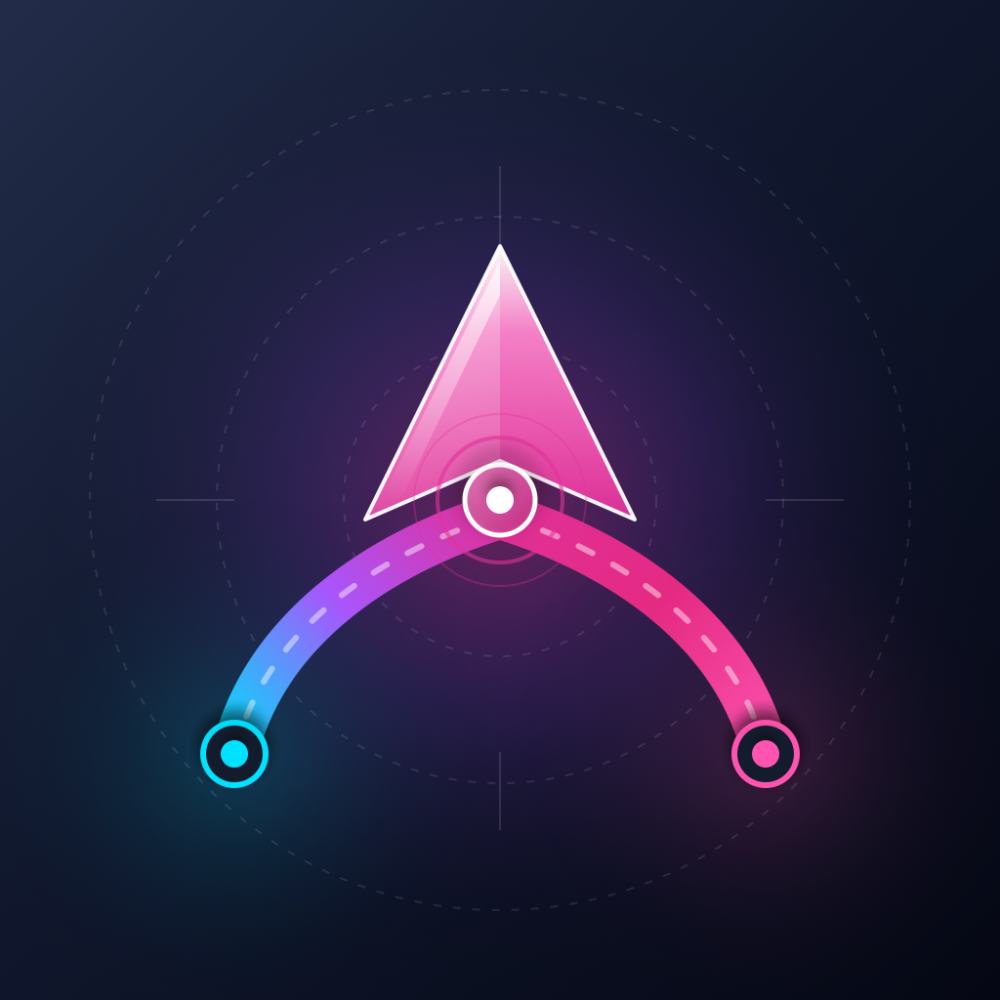
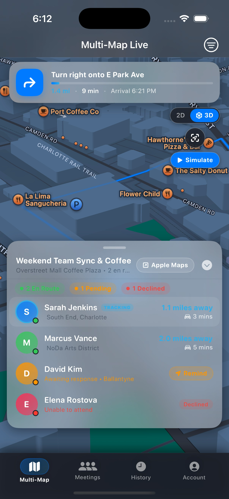
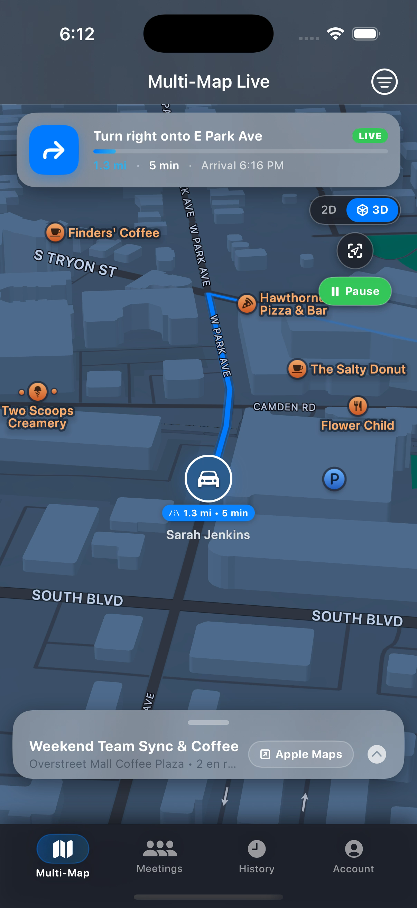
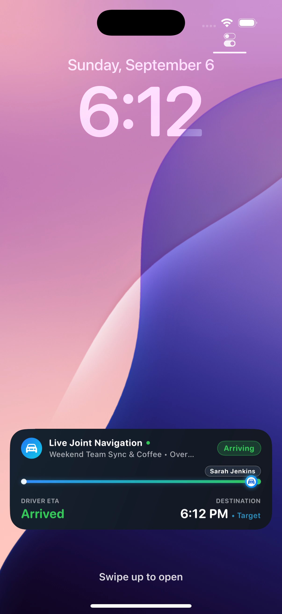
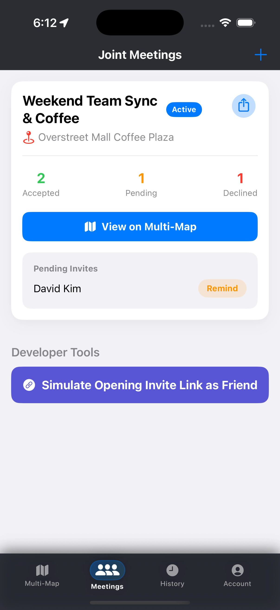
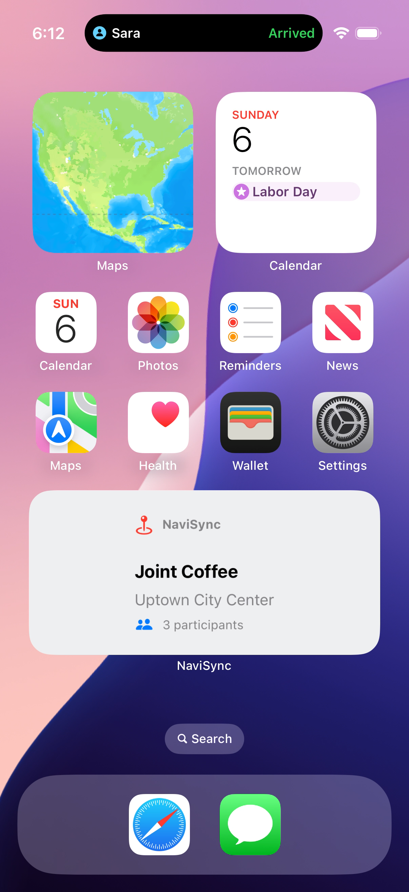
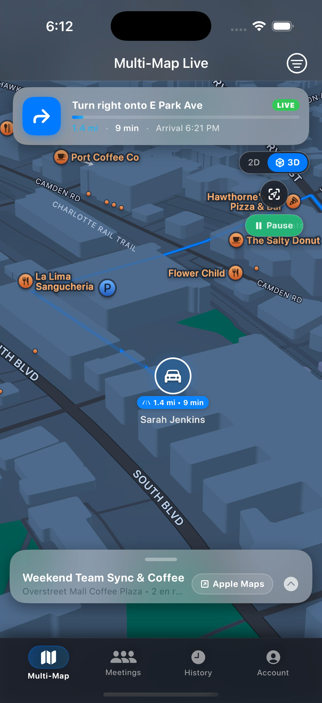
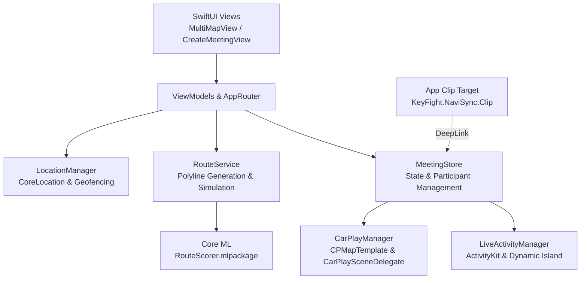

<div align="center">

  

  # NaviSync

  ### Arrive together.
  **Multi-party group navigation and arrival synchronization for iOS 17+**

  [](https://developer.apple.com/ios/)
  [](https://swift.org/)
  [](https://developer.apple.com/xcode/)
  [](https://developer.apple.com/carplay/)
  [](https://developer.apple.com/app-clips/)
  [](LICENSE)

  <br />

  <p align="center">
    <b>NaviSync</b> synchronizes group arrivals without the friction of endless group texts, 24/7 background battery drain, or forcing friends to install heavy tracking apps. Drop a pin, send a single iMessage link, and watch everyone’s live turn-by-turn route converge on one shared 3D map.
  </p>

  <br />

  

</div>

---

## 🧭 The Problem & The NaviSync Solution

| Traditional Group Travel Friction | The NaviSync Experience |
|:---|:---|
| ❌ *“Where are you?”* texts while driving | ✅ **Live Multi-Map**: Real-time road routes & live ETAs on one shared map |
| ❌ Friends refuse to download a 220+ MB app | ✅ **Instant App Clip**: Tap in iMessage, joins in 2 seconds, **0 MB** kept |
| ❌ Creepy 24/7 background location tracking | ✅ **Ephemeral by Design**: Location streams end instantly upon arrival |
| ❌ Phone distraction while navigating in the car | ✅ **Apple CarPlay & Dynamic Island**: Glanceable status on dashboard & Lock Screen |

---

## ✨ Key Capabilities

### 🗺️ Multi-Map Live Navigation
- **All Routes on One Screen**: Follow every attendee's real street route simultaneously rendered on Apple MapKit in 2D or 3D.
- **Dynamic Turn-by-Turn Card**: Top guidance banner gives ongoing directions while keeping the map interactive.
- **Attendee Status Roster**: Native bottom sheet displays who is `En Route`, who is `Pending`, and who `Declined`, complete with live distance badges (e.g. `1.3 mi · 5 min`) and one-tap reminders.
- **Apple Maps Hand-off**: Jump directly into Apple Maps navigation with a single tap.

### ⚡ Instant App Clips (No Full Install Required)
- **Universal Links**: Invitation URLs (`https://navisync.app/m/<meeting_id>`) trigger the native **iOS App Clip**.
- **Under 2-Second Launch**: Invited friends see a native bottom card slide up directly over iMessage.
- **Zero Storage Clutter**: Guests can view the destination, RSVP with their origin, and stream their ETA without creating an account or cluttering their Home Screen.

### 📱 Live Activities & Dynamic Island
- **ActivityKit Integration**: Real-time arrival progress displayed directly on the iOS Lock Screen.
- **Dynamic Island Compact & Expanded Modes**: Monitor arrival countdowns and approaching friends while using other apps.
- **Home Screen Widgets**: Glanceable status widgets for active group meetups and joint sessions.

### 🚗 Apple CarPlay Support
- **`CPMapTemplate` Integration**: Safe, driver-friendly dashboard experience designed specifically for road trip convoys and airport pickups.
- **In-App Simulator**: Includes a built-in CarPlay simulator (`CarPlaySimulatorView.swift`) for rapid testing without requiring a vehicle connection.

### 🧠 On-Device Core ML Route Intelligence
- **Trained Route Scorer**: Includes `RouteScorer.mlpackage` trained in Python to score routes, predict traffic variances, and anticipate arrival bottlenecks.
- **Local Execution**: All inference runs 100% on-device with zero server-side telemetry.

### 🔒 Ephemeral by Design
- **Session-Bound Streaming**: Location sharing is strictly tied to an active meetup.
- **Auto-Termination**: As soon as participants arrive within geofenced destination thresholds, sharing immediately disconnects. No location history is retained.

---

## 📸 Interface Gallery

<div align="center">
  <table>
    <tr>
      <td align="center" width="33%">
        <br />
        <b>Multi-Map Live & Guest Roster</b>
      </td>
      <td align="center" width="33%">
        <br />
        <b>3D Convoy Tracking & Route</b>
      </td>
      <td align="center" width="33%">
        <br />
        <b>Lock Screen & Dynamic Island</b>
      </td>
    </tr>
    <tr>
      <td align="center" width="33%">
        <br />
        <b>Joint Meetings Manager</b>
      </td>
      <td align="center" width="33%">
        <br />
        <b>WidgetKit Live Widgets</b>
      </td>
      <td align="center" width="33%">
        <br />
        <b>3D City Elevation & Polylines</b>
      </td>
    </tr>
  </table>
</div>

---

## 🛠️ Technology Stack & Architecture

NaviSync is built natively in Swift using Apple’s modern declarative frameworks:



| Component | Technology | Description |
|:---|:---|:---|
| **User Interface** | SwiftUI (iOS 17+) | Native declarative layout, responsive bottom sheets, and fluid spring animations |
| **Mapping Engine** | MapKit | Interactive 2D/3D map cameras, vector polylines, and custom avatar markers |
| **Background Location** | CoreLocation | Accurate geofencing, heading tracking, and arrival triggers |
| **Glanceable Status** | ActivityKit & WidgetKit | Real-time Lock Screen Live Activities and Dynamic Island presentations |
| **In-Vehicle UX** | CarPlay Framework | `CPMapTemplate` interface optimized for driver safety |
| **Instant Sharing** | App Clips | Associated Domains (`appclips:navisync.app`), under 2s launch via universal links |
| **Predictive Analytics** | Core ML | `RouteScorer.mlpackage` on-device delay and arrival window prediction |

---

## 📁 Repository Structure

```text
NaviSync/
├── NaviSync/                      # Main iOS App Target
│   ├── NaviSyncApp.swift          # App Entrypoint & AppClip URL Handling
│   ├── Models/                    # Domain Models
│   │   ├── Meeting.swift          # Meeting Session & Destination
│   │   ├── Participant.swift      # Attendee Status (En Route, Pending, Declined)
│   │   └── LocationPoint.swift    # Geo Coordinates & Route Markers
│   ├── Views/                     # SwiftUI Presentation Layer
│   │   ├── MultiMapView.swift     # Core Multi-Map Navigation Experience
│   │   ├── CreateMeetingView.swift# Quick Link & Location Composer
│   │   ├── MeetingListView.swift  # Scheduled & Active Meetups
│   │   └── CarPlaySimulatorView.swift # In-App CarPlay Emulation
│   ├── Services/                  # Business Logic & Infrastructure
│   │   ├── MeetingStore.swift     # Observable Meeting State Manager
│   │   ├── RouteService.swift     # Route Fetching & Movement Simulation
│   │   ├── LocationManager.swift  # CoreLocation & Permission Management
│   │   └── LiveActivityManager.swift # ActivityKit Lifecycle
│   ├── CarPlay/                   # Automotive Integration
│   │   ├── CarPlayManager.swift   # CPMapTemplate & Convoy UI
│   │   └── CarPlaySceneDelegate.swift # CarPlay Scene Lifecycle
│   └── Router/AppRouter.swift     # Deep Link Routing & Flow Control
├── NaviSyncWidget/                # WidgetKit & Live Activity Extension
│   ├── NaviSyncLiveActivity.swift # Lock Screen & Dynamic Island Layouts
│   └── NaviSyncWidget.swift       # Home Screen Dashboard Widgets
├── MLTraining/                    # Machine Learning Pipeline
│   ├── train_model.py             # Route Scorer Python Training Script
│   └── RouteScorer.mlpackage      # Compiled Core ML Model Package
├── website/                       # Product Landing Page
│   ├── index.html                 # Apple-Style Showcase Website
│   ├── styles.css                 # Responsive Design System & CSS Motion
│   └── app.js                     # Scroll-Driven Interaction & Intersection Observers
└── Screenshots/                   # Real Retina App Store & Showcase Assets
```

---

## 🚀 Getting Started

### Prerequisites
- **macOS Sonoma (14.0+)** or later
- **Xcode 15.0+** with the iOS 17 SDK installed
- **Apple Developer Account** (for testing App Clips or CarPlay entitlements on physical hardware)

### Quick Start
1. **Clone the repository:**
   ```bash
   git clone https://github.com/mrinalrajl/MultipleMap.git
   cd MultipleMap
   ```

2. **Open the project in Xcode:**
   ```bash
   open NaviSync.xcodeproj
   ```

3. **Select a Target & Simulator:**
   - Select the `NaviSync` scheme.
   - Choose any **iOS 17+ Simulator** (e.g. *iPhone 16 Pro* or *iPhone 15 Pro*).

4. **Build and Run:**
   - Press <kbd>Cmd</kbd> + <kbd>R</kbd> or click **Run**.
   - Tap **"Simulate"** in the Multi-Map view to observe real-time movement, live ETA recalculations, and dynamic status updates for demo attendees!

---

## ⚡ App Clip & Associated Domains Setup

To configure invitation URL invocation for App Clips:

1. **Associated Domains Entitlement**:
   Ensure `NaviSync.entitlements` contains the associated domain entries:
   ```xml
   <key>com.apple.developer.associated-domains</key>
   <array>
       <string>appclips:navisync.app</string>
       <string>webcredentials:navisync.app</string>
   </array>
   ```

2. **Bundle Identifier Configuration**:
   - Main App: `KeyFight.NaviSync`
   - App Clip Target: `KeyFight.NaviSync.Clip`

3. **URL Pattern**:
   Universal links follow the standard pattern:
   ```text
   https://navisync.app/m/{meeting_id}
   ```
   Tapping this link on any iOS device invokes the App Clip card directly over iMessage or Safari without redirecting to the full App Store page.

---

## 🚘 CarPlay Testing

NaviSync provides two testing paths for CarPlay:

1. **Xcode CarPlay Simulator**:
   - In Xcode, go to **Simulator > I/O > External Displays > CarPlay**.
   - The CarPlay interface will automatically attach using `CarPlaySceneDelegate.swift`.
2. **In-App CarPlay Preview**:
   - Navigate to the in-app Developer Settings inside NaviSync and open `CarPlaySimulatorView` to preview the map template UI directly on the device.

---

## 📄 License

This project is licensed under the **MIT License** — see the [LICENSE](LICENSE) file for full details.

---

<div align="center">
  <sub>Built with ❤️ using SwiftUI, MapKit, ActivityKit, and CarPlay.</sub>
</div>
